<div align="center">

<picture>
  <source media="(prefers-color-scheme: dark)" srcset="apps/web/public/brand/logo-dark.svg">
  
</picture>

**Restaurant management software for POS, orders, tables, kitchen display, QR ordering, billing and reports, in English and Arabic, running on Cloudflare.**

[](LICENSE)

[Screenshots](#screenshots) ·
[Features](#features) ·
[Local setup](#local-setup) ·
[Environment variables](#environment-variables) ·
[Deployment](#deployment) ·
[Known limitations](#known-limitations) ·
[Licence](#licence-and-attribution)

</div>

## Overview

Ahemad's Restro is a restaurant management system: point of sale, kitchen
display, tables and floor plans, QR self-ordering, kiosk, menu, inventory and
procurement, staff and roles, reservations, delivery, loyalty and gift cards,
accounting and reports. It runs on Cloudflare (Workers, D1, R2, Durable
Objects) and is set up for Saudi Arabia by default: English and Arabic with
right-to-left layouts, Saudi Riyal pricing, Asia/Riyadh time, Saudi VAT (15 %
default, VAT-inclusive) and ZATCA Phase 1 QR codes on simplified tax invoices.

It is a fork and migration of the open-source
[Nodedr OrderRestro](https://github.com/Raktim94/nodedr-restaurant-pos)
(self-hosted NestJS + PostgreSQL + Next.js) by Nodedr Infotech Private
Limited and Raktim Ranjit. The business logic, API and screens come from that
project; this edition moved it to Cloudflare and added the Saudi
localisation, a redesigned interface, a public marketing site and the
Ahemad's Restro brand. See [Licence and attribution](#licence-and-attribution).

**Status:** not deployed anywhere yet. Everything below has been run locally
with Wrangler's simulators; nothing has run on a real Cloudflare account.

## Screenshots

Real screenshots of the application running locally with demo data
(`scripts/assets/screenshots.mjs`), not mock-ups.

| Dashboard | Point of sale |
|---|---|
| 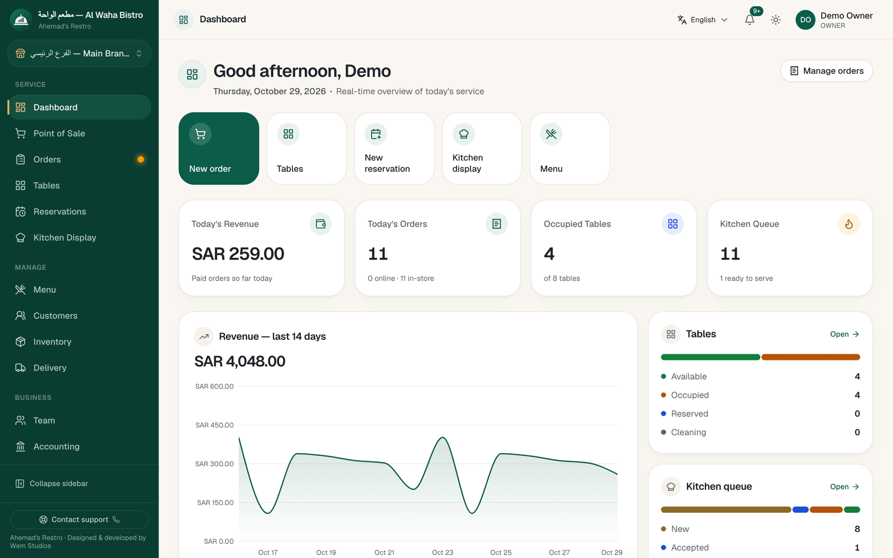 | 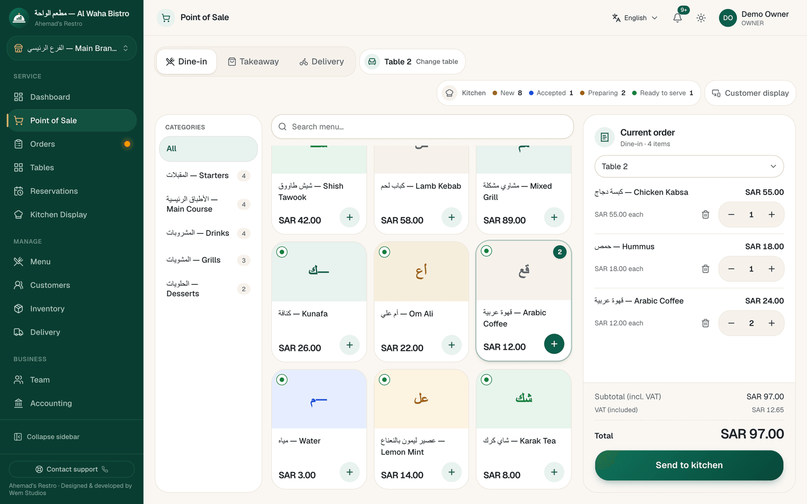 |
| **Kitchen display** | **Tables** |
| 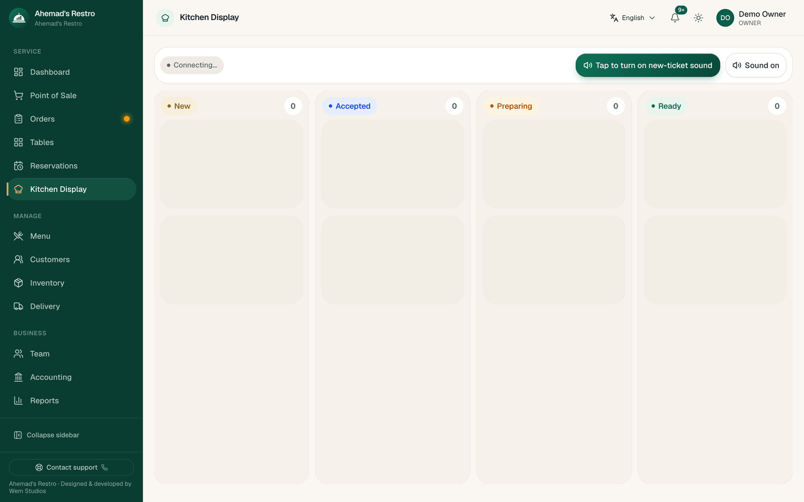 | 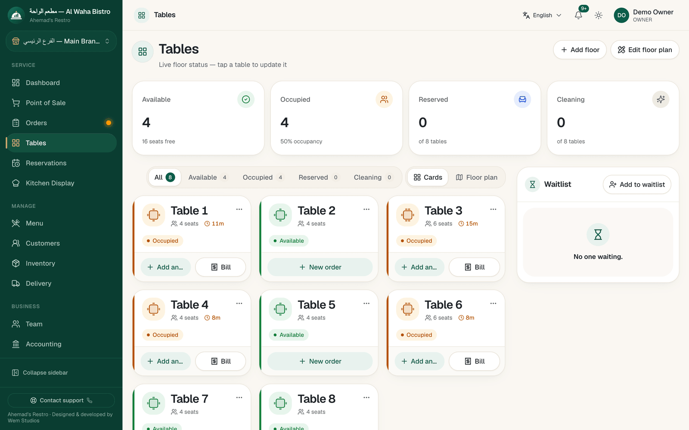 |
| **Orders** | **Order detail** |
| 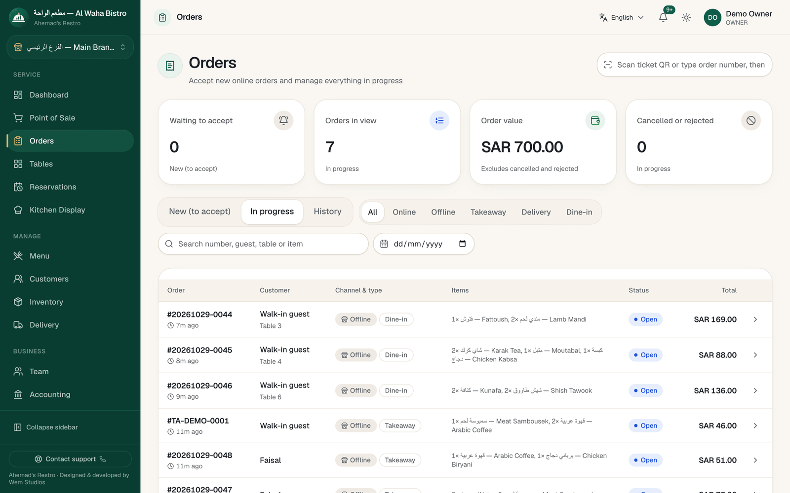 | 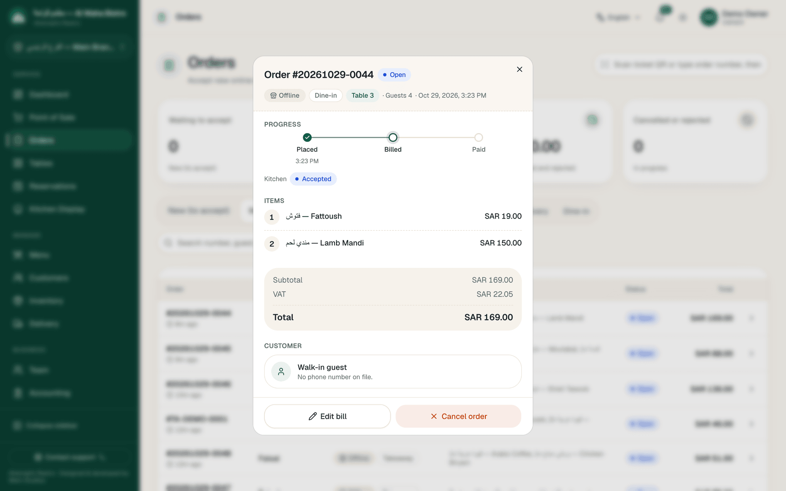 |
| **Menu** | **Reports** |
| 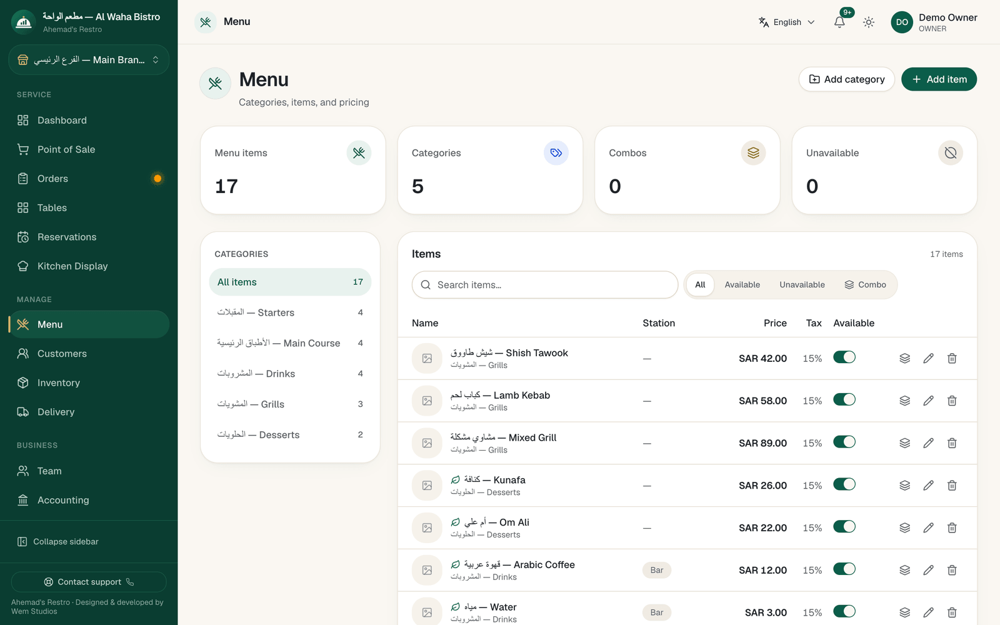 | 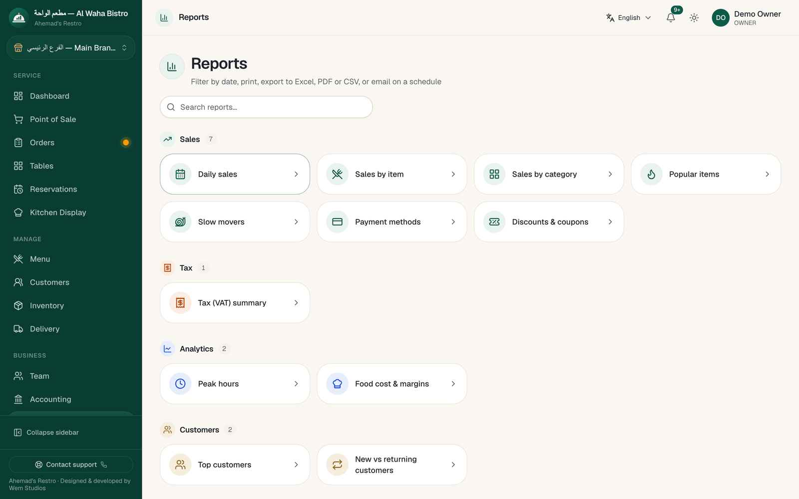 |

Arabic (right-to-left):

| Dashboard (Arabic) | Point of sale (Arabic) |
|---|---|
| 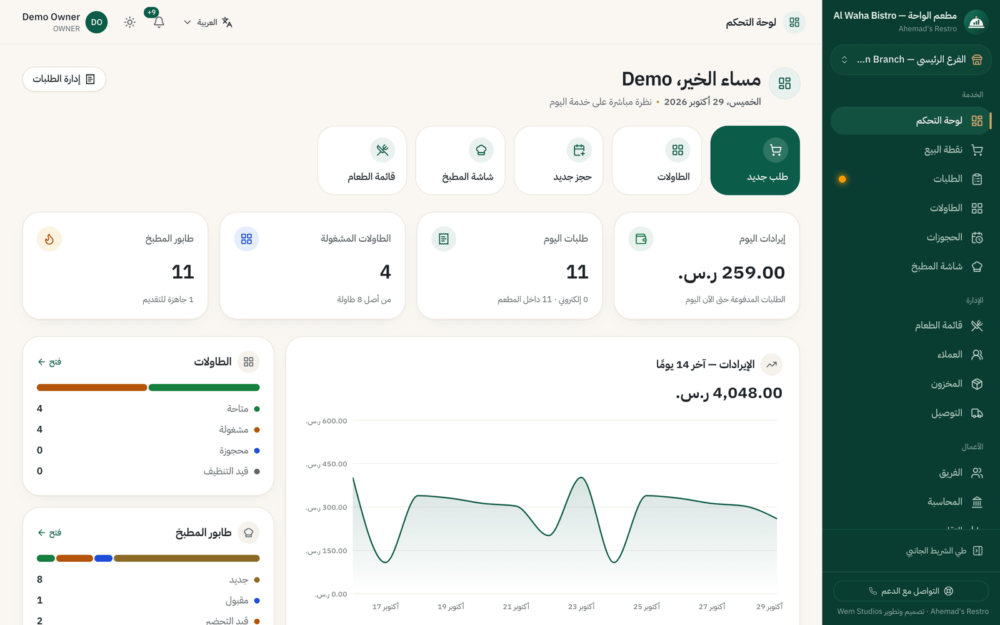 | 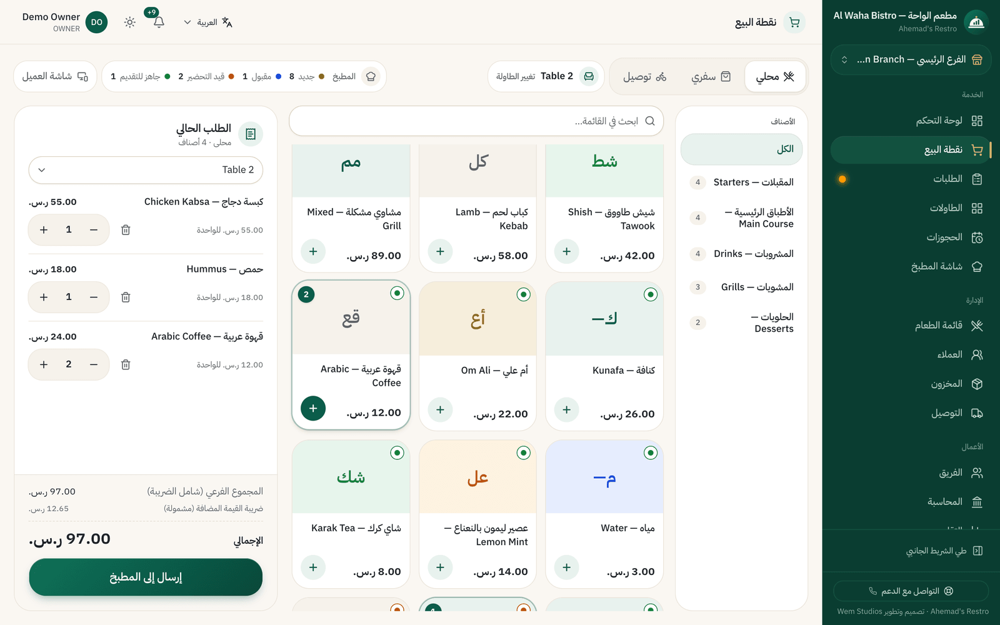 |

Phones, and a printed receipt (ZATCA simplified tax invoice with QR):

| Dashboard | POS | Kitchen display (Arabic) | Receipt (Arabic) |
|---|---|---|---|
| 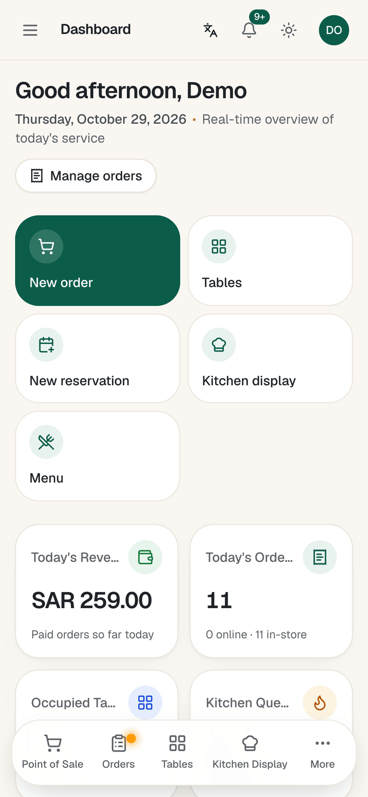 | 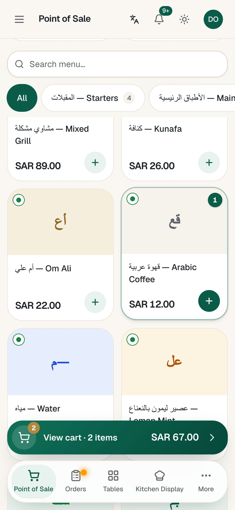 | 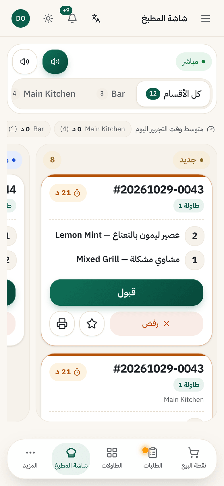 | 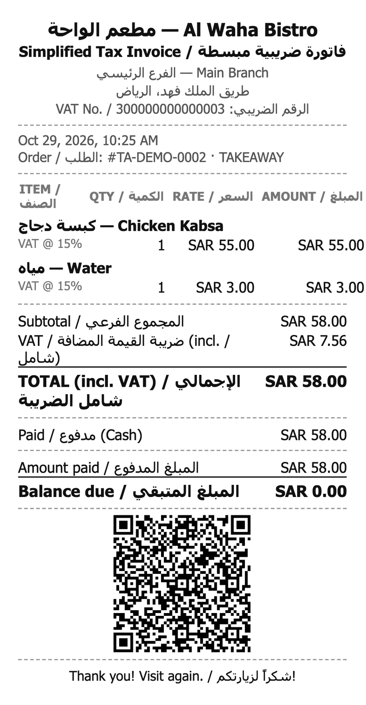 |

Every screenshot exists in English and Arabic, as PNG and WebP, in
[`apps/web/public/images/product/screens/`](apps/web/public/images/product/screens/).
Inventory of all images: [docs/marketing/ASSETS.md](docs/marketing/ASSETS.md).

## Features

Each module's status, how it was verified and its documented differences from
the original are in
[docs/cloudflare/FEATURE-CHECKLIST.md](docs/cloudflare/FEATURE-CHECKLIST.md).

**Service**
- Point of sale: dine-in, takeaway, delivery and scheduled orders; modifiers
  and combos; discounts, coupons and tips; partial payments and refunds.
- Kitchen display (KDS) with stations and sounds, updated live over WebSockets.
- Tables, floors and a floor designer; QR codes per table.
- QR self-ordering for guests and table requests; self-service kiosk
  (Arabic by default, English as the second language).
- Receipts and bills printed from the browser; bilingual ZATCA simplified
  tax invoice for Saudi VAT branches.
- Network (port 9100) ESC/POS thermal printing, with the limits listed under
  [Known limitations](#known-limitations).

**Back office**
- Menu, categories, items, modifiers, combos and availability.
- Customers and CRM, loyalty, gift cards, reservations and waitlist.
- Delivery zones and drivers.
- Inventory, recipes, stock, waste and transfers; procurement (requests,
  quotations, purchase orders, goods receipts, supplier invoices and payments).
- Accounting, expenses, budgets and bank reconciliation.
- HR: attendance, shifts, leave and payroll.
- Marketing campaigns, promotions and coupons (e-mail through Resend or SendGrid).
- Reports with CSV, XLSX and PDF export (PDFs support Arabic) and scheduled
  report e-mails.
- Operations: equipment, maintenance and documents (attachments in R2).
- Several branches per restaurant, including adding a branch from
  Settings → Branches (`POST /api/v1/branches`).

**Platform**
- Sign-in with password, staff PIN quick-switch and TOTP two-factor;
  role-based permissions with per-branch access; audit log.
- Signed, retried webhooks; integration API keys and personal API keys; an
  MCP server at `/api/v1/mcp` (bundled, not exercised by the tests).
- In-app backups to R2 (verified, downloadable, restorable) on top of D1
  Time Travel.
- English and Arabic throughout, with RTL layouts, IBM Plex Sans Arabic, SAR
  formatting and Asia/Riyadh time; light and dark themes.

**Public website**
- Marketing site in English and Arabic (`/en`, `/ar`): home page, solution
  pages, blog, privacy policy and terms. Screenshots are served as WebP;
  Arabic pages use their own Open Graph image (`og-default-ar.png`).
- Demo request form stored in D1, with optional e-mail notification and a
  token-protected list endpoint.

## Tech stack

| Layer | Technology |
|---|---|
| API | NestJS 11 on Cloudflare Workers (`nodejs_compat`), bundled with esbuild (`apps/api/build.mjs`) |
| Database | Cloudflare D1 (SQLite) through Prisma 7 and `@prisma/adapter-d1` |
| Files and backups | Cloudflare R2 |
| Realtime and write isolation | Durable Objects (`RealtimeHub`, `WriteLock`) with WebSocket hibernation |
| Scheduled jobs | Cron Triggers |
| Web app and site | Next.js 16 (App Router) on Workers via OpenNext (`@opennextjs/cloudflare`), Tailwind CSS 4, shadcn/ui |
| Shared code | `packages/types`: Zod schemas, tax regimes, regional defaults, ZATCA QR, brand config |
| Tooling | pnpm 11 workspaces, Turborepo, TypeScript, Jest, `node:test`, ESLint, Wrangler 4 |

## Architecture

```
 browser ──HTTPS──► ahemads-restro-web   (Worker: OpenNext build of apps/web + static assets)
                      │ /api/* and /api/realtime (service binding "API", same origin)
                      ▼
                    ahemads-restro-api   (Worker: NestJS app from apps/api)
                      ├── D1  "DB"          application data
                      ├── R2  "UPLOADS"     menu photos, logos, document attachments
                      ├── R2  "BACKUPS"     database exports
                      ├── DO  "REALTIME"    RealtimeHub, one per restaurant (WebSockets)
                      ├── DO  "WRITE_LOCK"  WriteLock, one per restaurant
                      ├── Rate Limiting     sign-in and public endpoints
                      └── Cron Triggers     scheduled orders, report e-mails, webhooks, backups
```

The browser talks to one origin; the web Worker forwards `/api` to the API
Worker over a service binding, so the session cookie stays first-party and
httpOnly. Details and the reasoning behind each choice:
[docs/cloudflare/ARCHITECTURE.md](docs/cloudflare/ARCHITECTURE.md).

## Repository layout

```
apps/api            NestJS API on Cloudflare Workers (D1, R2, Durable Objects, Cron)
  migrations/       D1 migrations (applied by Wrangler)
  prisma/           schema.prisma, seed.ts, original PostgreSQL migrations (reference only)
  scripts/          new-migration.mjs
apps/web            Next.js application and public website on Workers via OpenNext
  app/(app)/        the restaurant application (noindex)
  app/(site)/       the marketing site: /en, /ar, solution pages, blog, legal
  content/site/     marketing copy, solution pages, blog articles, legal texts
  messages/{en,ar}/ application translations
packages/types      shared Zod schemas, tax, regional defaults, ZATCA QR, brand config
scripts/assets      logo/icon, screenshot and marketing graphic generators
scripts/migration   PostgreSQL -> D1/R2 data migration (export, transform, import, validate)
scripts/verify      end-to-end smoke test
docs/cloudflare     architecture, deployment, database, operations, localisation, reports
docs/marketing      keyword map, editorial plan, asset inventory, analytics setup
docs/original       the upstream (self-hosted) documentation, kept for history
```

## Requirements

- **Node.js 24**, or 22.12+ (Prisma 7 refuses Node 23). `db:new-migration`
  uses `node:sqlite`, which needs Node 22.13+ or 24.
- **pnpm 11** (`corepack enable`).
- For deployment only: a Cloudflare account on **Workers Paid** (bcrypt and
  PDF/XLSX exports need more CPU time than the Free plan allows, and the API
  bundle exceeds the Free plan's size limit).
- For regenerating screenshots and graphics only: a local Google Chrome
  (set `CHROME_PATH` if it is not in the default macOS location).

## Local setup

Everything runs locally with Wrangler's simulators (local D1, R2 and Durable
Objects); no Cloudflare account is needed.

```bash
pnpm install                                         # also runs `prisma generate`
pnpm --filter @ahemads-restro/types build
cp apps/api/.dev.vars.example apps/api/.dev.vars     # then set JWT_SECRET (openssl rand -hex 32)
pnpm db:migrate:local                                # creates the local D1 schema
pnpm db:seed:local                                   # optional demo restaurant (Arabic/English menu, SAR)

pnpm --filter @ahemads-restro/api dev                # API on http://localhost:8787
pnpm --filter @ahemads-restro/web preview            # OpenNext build + web Worker on http://localhost:1995
```

Demo sign-in after seeding: `owner@demo.local` / `Password123!`. This account
exists only in the local seed data; never create it on a real deployment.

For hot reload of the frontend, use `next dev` instead of `preview` (the API
must still be running):

```bash
cp apps/web/.env.example apps/web/.env.local
pnpm --filter @ahemads-restro/web dev                # http://localhost:1995
```

Open <http://localhost:1995/en> for the marketing site and
<http://localhost:1995/login> for the application. More, including how to
fire Cron Triggers locally:
[docs/cloudflare/LOCAL-DEVELOPMENT.md](docs/cloudflare/LOCAL-DEVELOPMENT.md).

## Environment variables

API values are Worker bindings: secrets go in `apps/api/.dev.vars` locally
and `wrangler secret put <NAME> --env <staging|production>` when deployed;
non-secret values go in `vars` in `apps/api/wrangler.jsonc` (`.dev.vars` also
works locally). Web values are `NEXT_PUBLIC_*` build-time variables, inlined
when the web app is built (`apps/web/.env.local` for `next dev`; the build
environment for `preview`, `build:cf` and `deploy:*`). Templates:
[`apps/api/.dev.vars.example`](apps/api/.dev.vars.example) and
[`apps/web/.env.example`](apps/web/.env.example). Never commit real values.

### API Worker

| Name | Where | Required | Purpose |
|---|---|---|---|
| `JWT_SECRET` | `.dev.vars` / `wrangler secret` | **yes** | Signs session tokens. At least 32 characters and not a known placeholder, otherwise the API answers 503. |
| `JWT_EXPIRES_IN` | `vars` | no | Session lifetime (default `12h`). |
| `WEBHOOK_KEY` | `.dev.vars` / `wrangler secret` | no | Key for sealing webhook signing secrets at rest; falls back to `JWT_SECRET`. |
| `TWO_FACTOR_KEY` | `.dev.vars` / `wrangler secret` | no | Key for encrypting TOTP secrets at rest; falls back to `JWT_SECRET`. Keep it stable once set. |
| `EMAIL_PROVIDER` | `vars` | no | `resend` (default) or `sendgrid`. |
| `EMAIL_API_KEY` | `.dev.vars` / `wrangler secret` | no | E-mail provider API key. Without it and `EMAIL_FROM`, e-mail features refuse to send. |
| `EMAIL_FROM` | `vars` | no | Sender, e.g. `My Restaurant <orders@example.com>`, on a domain verified with the provider. |
| `LEADS_ACCESS_TOKEN` | `.dev.vars` / `wrangler secret` | no | Bearer token for `GET /api/v1/leads/demo-requests`. At least 24 characters; while unset the endpoint always answers 401. |
| `DEMO_NOTIFY_EMAIL` | `vars` or `wrangler secret` | no | Receives an e-mail per demo request (needs the e-mail settings above). Requests are stored in D1 either way. |
| `RELEASES_REPO` | `vars` | no | GitHub `owner/name` whose releases drive the "new version" notice. Unset disables the update check. |
| `CORS_ORIGIN` | `vars` | set in config | Allowed browser origin(s), comma-separated (default `http://localhost:1995`). |
| `COOKIE_SECURE` | `vars` | set in config | `true` in staging/production so the session cookie is HTTPS-only. |
| `NODE_ENV` | `vars` | set in config | `production` hides Swagger UI unless `ENABLE_SWAGGER=true`. |
| `ENABLE_SWAGGER` | `vars` | no | `true` serves Swagger UI at `/api/docs` in production. |
| `APP_VERSION` | `vars` | set in config | Version shown in the app (`2.0.0`; `2.0.0-dev` locally). |
| `BACKUP_INTERVAL_DAYS`, `BACKUP_RETAIN_COUNT` | `vars` | no | Backup schedule defaults until a schedule is saved in Settings (3 days, keep 2). |
| `WEBHOOKS_ALLOW_PRIVATE`, `WEBHOOKS_ALLOW_INSECURE` | `vars` | no | Relax the webhook URL checks. Workers cannot reach private networks regardless. |
| `VERIFACTU_*` | `vars` / `wrangler secret` | no | Spain VERI\*FACTU only ([docs/verifactu.md](docs/verifactu.md)); outside this edition's scope. |

`apps/api/wrangler.jsonc` also sets `DEFAULT_COUNTRY`, `DEFAULT_CURRENCY` and
`DEFAULT_TIMEZONE`, but the code does not read them: regional defaults come
from `packages/types/src/region.ts` and the database schema defaults.

### Web build

| Name | Where | Required | Purpose |
|---|---|---|---|
| `NEXT_PUBLIC_SITE_URL` | web build environment | **yes, for a public build** | Canonical origin for canonical URLs, hreflang, Open Graph, `sitemap.xml` and `robots.txt`. Falls back to `http://localhost:1995`. |
| `NEXT_PUBLIC_SOURCE_CODE_URL` | web build environment | **yes, before going public** | Repository linked from the site footer as the AGPL-3.0 source offer. Falls back to the upstream repository, which does not contain this edition's changes. |
| `NEXT_PUBLIC_GA_MEASUREMENT_ID` | web build environment | no | Google Analytics 4 id. Analytics loads only when set and only after the visitor consents. |
| `NEXT_PUBLIC_GSC_VERIFICATION` | web build environment | no | Google Search Console HTML-tag token (DNS verification needs nothing). |
| `NEXT_PUBLIC_SUPPORT_EMAIL` | web build environment | no | Public support address in the site footer; nothing is shown while unset. |
| `NEXT_PUBLIC_WS_URL` | `apps/web/.env.local` | `next dev` only | Realtime socket URL, because `next dev` cannot proxy WebSockets (`ws://localhost:8787`). |
| `API_DEV_URL` | `apps/web/.env.local` | `next dev` only | Where `next dev` proxies `/api/*` (default `http://localhost:8787`). |

Leave an optional variable out rather than setting it to an empty value: an
empty `NEXT_PUBLIC_SITE_URL=` or `NEXT_PUBLIC_SOURCE_CODE_URL=` replaces the
fallback with an empty string.

## Cloudflare resources

Names come from [`apps/api/wrangler.jsonc`](apps/api/wrangler.jsonc) and
[`apps/web/wrangler.jsonc`](apps/web/wrangler.jsonc).

| Resource | Binding | Local (`wrangler dev`) | Staging | Production |
|---|---|---|---|---|
| API Worker | — | `ahemads-restro-api` | `ahemads-restro-api-staging` | `ahemads-restro-api-production` |
| Web Worker | `API` → API Worker | `ahemads-restro-web` | `ahemads-restro-web-staging` | `ahemads-restro-web-production` |
| D1 database | `DB` | `ahemads-restro-dev` | `ahemads-restro-staging` | `ahemads-restro-production` |
| R2 bucket | `UPLOADS` | `ahemads-restro-uploads-dev` | `ahemads-restro-uploads-staging` | `ahemads-restro-uploads-production` |
| R2 bucket | `BACKUPS` | `ahemads-restro-backups-dev` | `ahemads-restro-backups-staging` | `ahemads-restro-backups-production` |
| Durable Objects | `REALTIME`, `WRITE_LOCK` | classes `RealtimeHub`, `WriteLock` | same | same |
| Rate limiters | `AUTH_RATE_LIMITER`, `PUBLIC_RATE_LIMITER` | 10 and 30 requests per 60 s | same | same |

### D1

```bash
# create (once per environment), then copy the printed id into apps/api/wrangler.jsonc
pnpm --filter @ahemads-restro/api exec wrangler d1 create ahemads-restro-staging

# apply the migrations in apps/api/migrations/
pnpm db:migrate:local
pnpm --filter @ahemads-restro/api db:migrate:staging
pnpm --filter @ahemads-restro/api db:migrate:production

# after editing apps/api/prisma/schema.prisma: write the next numbered migration
pnpm --filter @ahemads-restro/api db:new-migration add_something
```

`db:new-migration` (`apps/api/scripts/new-migration.mjs`) diffs the existing
migrations against the schema with `prisma migrate diff` and writes
`migrations/000N_<name>.sql`. Review the SQL before applying it. D1 has no
interactive transactions; isolation comes from the per-restaurant write lock.
See [docs/cloudflare/DATABASE.md](docs/cloudflare/DATABASE.md).

### R2

```bash
pnpm --filter @ahemads-restro/api exec wrangler r2 bucket create ahemads-restro-uploads-staging
pnpm --filter @ahemads-restro/api exec wrangler r2 bucket create ahemads-restro-backups-staging
```

`UPLOADS` holds menu photos and logos (`uploads/`) and document attachments
(`documents/`); `BACKUPS` holds the in-app database exports. R2 has no
undelete; see [docs/cloudflare/OPERATIONS.md](docs/cloudflare/OPERATIONS.md).

### Durable Objects

No pre-creation is needed: the `migrations` block in `apps/api/wrangler.jsonc`
creates the `RealtimeHub` and `WriteLock` classes on first deploy.
`RealtimeHub` holds one restaurant's WebSockets
([docs/cloudflare/REALTIME.md](docs/cloudflare/REALTIME.md)); `WriteLock`
serialises one restaurant's writes.

## Build, test and lint

```bash
pnpm typecheck
pnpm lint
pnpm test                 # API (Jest), web (node:test), migration tooling
pnpm i18n:check           # English/Arabic key parity
pnpm build:cf             # Workers builds
pnpm test:smoke           # end-to-end against the running local API (port 8787)
pnpm test:migration       # PostgreSQL -> D1 round trip (needs PostgreSQL binaries)
```

CI ([`.github/workflows/ci.yml`](.github/workflows/ci.yml)) runs the type
check, unit tests, translation check, both Worker builds, the smoke test on a
local D1 and the migration test. It does not run `pnpm lint`.

## Deployment

Not deployed. The configuration has been validated with
`wrangler deploy --dry-run` for staging and production only. Steps (create
D1 and R2, set secrets, migrate, deploy the API first and then the web
Worker, attach a hostname, smoke-test):
[docs/cloudflare/DEPLOYMENT.md](docs/cloudflare/DEPLOYMENT.md).

```bash
pnpm deploy:staging       # API, then web
pnpm deploy:production
```

Before deploying, set the `NEXT_PUBLIC_*` variables in the environment of
the web build and `CORS_ORIGIN` in each environment's `vars`. Moving data
from an existing PostgreSQL installation:
[docs/cloudflare/DATA-MIGRATION.md](docs/cloudflare/DATA-MIGRATION.md).
Backups, Time Travel and monitoring:
[docs/cloudflare/OPERATIONS.md](docs/cloudflare/OPERATIONS.md).

## Marketing site and SEO

- `/` redirects to `/ar` for browsers that prefer Arabic and to `/en`
  otherwise (temporary redirects in `apps/web/next.config.ts`).
- Routes under `apps/web/app/(site)/[lang]/`: home, solution pages
  (`/[lang]/[slug]`), blog (`/[lang]/blog`, `/[lang]/blog/[post]`),
  `/[lang]/privacy` and `/[lang]/terms`. Some pages exist in one language
  only (for example `restaurant-software-india` is English only).
- Each page has a self-referencing canonical URL, `hreflang` alternates only
  for the languages it exists in plus `x-default`, and Open Graph/Twitter
  images (`apps/web/lib/site/seo.ts`).
- Structured data (JSON-LD): Organization, WebSite, SoftwareApplication,
  WebPage, BreadcrumbList, Article and FAQPage (`apps/web/lib/site/jsonld.ts`).
- `sitemap.xml` (`apps/web/app/sitemap.ts`) lists only public marketing pages
  with their language alternates; `robots.txt` (`apps/web/app/robots.ts`)
  disallows the API, the application and the guest QR/kiosk links, and the
  application layout sends `noindex`.
- Content lives in [`apps/web/content/site/`](apps/web/content/site/):
  `home.ts`, `common.ts`, `pricing.ts` (no prices are set; every plan shows
  "Contact for pricing"), `solutions/`, `blog/` and `legal/`.
- Planning: [docs/marketing/KEYWORD-MAP.md](docs/marketing/KEYWORD-MAP.md),
  [docs/marketing/EDITORIAL-PLAN.md](docs/marketing/EDITORIAL-PLAN.md).
  Analytics and Search Console:
  [docs/marketing/ANALYTICS-AND-SEARCH-CONSOLE.md](docs/marketing/ANALYTICS-AND-SEARCH-CONSOLE.md).

## Internationalisation

- Application translations: `apps/web/messages/{en,ar}/<area>.json`, one file
  per screen area. English and Arabic are complete (2,342 keys each at the
  time of writing); Spanish and French from the original remain partial and
  fall back to English.
- `pnpm i18n:check` fails when a key is missing in Arabic or used in code
  without an English source. Add every new key to both languages.
- Choosing Arabic sets `<html lang="ar" dir="rtl">` before first paint;
  layouts use logical utilities (`ms-`/`me-`/`ps-`/`pe-`/`start-`/`end-`).
- Marketing copy is not in `messages/`: it lives per language in
  `apps/web/content/site/`.

Details: [docs/cloudflare/SAUDI-LOCALIZATION.md](docs/cloudflare/SAUDI-LOCALIZATION.md).

## Saudi configuration

- New restaurants default to SAR, Asia/Riyadh, country SA and the `SA_VAT`
  tax regime (`packages/types/src/region.ts`); existing or migrated
  restaurants keep their own settings.
- `SA_VAT`: 15 % default rate for new menu items, VAT-inclusive pricing and
  per-item rates (so zero-rated or exempt items are possible). Tax is always
  computed on the server.
- ZATCA **Phase 1**: a paid receipt from an `SA_VAT` branch with a VAT number
  is a bilingual simplified tax invoice with the required QR code (Base64 TLV,
  `packages/types/src/zatca.ts`).
- ZATCA **Phase 2** (FATOORA integration: UBL XML, cryptographic stamp,
  clearance/reporting) is **not included**.
- Payment methods include mada, STC Pay and Apple Pay, recorded by staff.

Confirm the VAT rate and any item-specific treatment with ZATCA or a tax
adviser before going live. Nothing in this repository is tax advice.

## Brand assets, screenshots and graphics

Generated from code by the `@ahemads-restro/asset-tools` package in
`scripts/assets/`:

```bash
pnpm --filter @ahemads-restro/asset-tools brand        # logos and icons
pnpm --filter @ahemads-restro/asset-tools screenshots  # real screenshots (needs the API on :8787 and web on :1995)
pnpm --filter @ahemads-restro/asset-tools graphics     # composites of the real screenshots
```

Screenshots need a fresh local database filled by `scripts/assets/demo-data.mjs`,
which refuses to run against anything but a local API. Procedure, inventory,
colour palette and usage rules: [docs/marketing/ASSETS.md](docs/marketing/ASSETS.md).

## Security

Report vulnerabilities privately as described in [SECURITY.md](SECURITY.md);
do not open public issues for them. Secrets belong in `wrangler secret`, never
in `wrangler.jsonc` or a committed `.dev.vars`.

## Known limitations

- **ZATCA Phase 2** (FATOORA integration) is not included.
- **No payment gateway**: payments (cash, card, mada, STC Pay, Apple Pay and
  others) are recorded by staff after the terminal or wallet approves them.
- **ESC/POS thermal printing** prints no Arabic text and no ZATCA QR code
  (printer code pages have no Arabic glyphs). Browser printing has both.
- **USB thermal printers** cannot be used from Workers; network printers must
  be reachable from the internet.
- **3-decimal currencies** (KWD, BHD, OMR) are rounded to 2 decimals by the
  server-side pricing.
- **Dietary flags**: only "vegetarian" can be edited in the menu UI; vegan,
  halal and gluten-free exist in the data model only.
- **Legal pages** (`apps/web/content/site/legal/`) contain bracketed
  placeholders (legal entity, address, jurisdiction, liability) and must be
  completed and reviewed by legal counsel before publication.
- **Open sign-up**: `/signup` (`POST /api/v1/auth/register`, rate-limited)
  lets anyone create a new restaurant on a deployment; there is no setting to
  close it. Restrict it at the edge (WAF rule or Cloudflare Access) if the
  deployment should not accept new restaurants.
- **Not deployed**: nothing has been tested on a real Cloudflare account, with
  real e-mail sending, network printers, the MCP endpoint, load at scale,
  Safari/iOS or a real production data migration.
- **No rollback inside interactive transactions** on D1. Isolation is kept by
  the per-restaurant write lock, which also serialises each restaurant's
  writes; load-test busy sites.
- **Cold starts**: a new isolate boots the Nest app (about 1 s locally).
- **Prisma query batching is disabled across requests**: Prisma normally
  merges concurrent `findUnique` calls from different requests into one
  query; on Workers a cancelled request then left the other requests hanging
  until the runtime killed them. `apps/api/src/prisma/prisma.service.ts` keeps
  batching only inside an array `$transaction`. This costs some extra D1
  queries under concurrent load, and the patch relies on a Prisma internal:
  the API refuses to start (error "Prisma internals changed") if a Prisma
  upgrade removes it, so re-test after upgrading Prisma.
- **Restaurant time zone for day boundaries**: the dashboard's "today"
  figures and daily trends use the restaurant's time zone (Workers run in
  UTC). Check other date-bucketed reports against the restaurant time zone
  before relying on them around midnight.
- **Not available on Cloudflare**: server sync for desktop installs, the
  Docker updater, self-hosted packaging. **VERI\*FACTU** (Spain) submission
  would need an mTLS certificate binding.
- **E-mail** needs a Resend or SendGrid account and a verified sender domain.
- **Arabic plurals** use one form; server-generated text (API errors,
  notification bodies, some report cells) is English.
- **Delivery zone form defaults** (fee 40) come from the original and should
  be reviewed for SAR.

Full list and test results:
[docs/cloudflare/MIGRATION-REPORT.md](docs/cloudflare/MIGRATION-REPORT.md).

## Contributing

See [CONTRIBUTING.md](CONTRIBUTING.md) and the [Code of Conduct](CODE_OF_CONDUCT.md).
Contributions are accepted under AGPL-3.0-only.

## Licence and attribution

Licensed under the **GNU Affero General Public License v3.0 only**
([LICENSE](LICENSE), SPDX `AGPL-3.0-only`).

Based on [Nodedr OrderRestro](https://github.com/Raktim94/nodedr-restaurant-pos),
Copyright (C) 2026 Nodedr Infotech Private Limited and Raktim Ranjit, also
licensed AGPL-3.0-only. The upstream copyright notices are kept; the changes
made in this edition are listed in [NOTICE](NOTICE) and
[CHANGELOG.md](CHANGELOG.md). Third-party components keep their own licences;
see [NOTICE](NOTICE) and [docs/LICENSE-REVIEW.md](docs/LICENSE-REVIEW.md).

**Network use (AGPL-3.0 section 13).** Anyone who runs a modified version of
this software for users over a network must offer those users the
corresponding source code. The public site's footer links to
`NEXT_PUBLIC_SOURCE_CODE_URL` for that purpose; set it to the repository that
holds the exact code you deploy.

## Designed and developed by Wem Studios

This edition (Cloudflare migration, Saudi localisation, redesign, the
Ahemad's Restro brand and website) is designed and developed by
**[Wem Studios](https://wemstudios.in/)**. The upstream code remains the work
of its authors, and third-party code belongs to its respective owners.

## Contact

Wem Studios

- Website: <https://wemstudios.in/>
- Phone: [+91 8308042362](tel:+918308042362)

Security reports: see [SECURITY.md](SECURITY.md).
